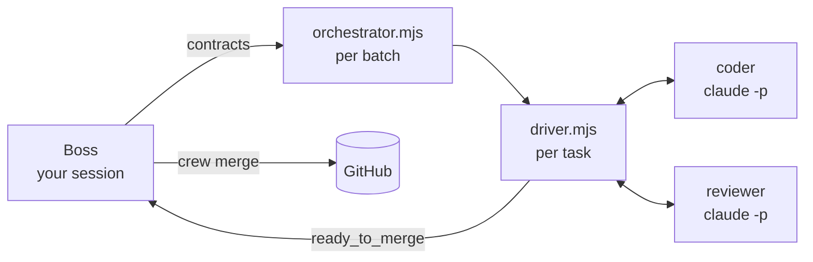

# the-crew

Run a batch of GitHub issues in parallel with [Claude Code](https://docs.claude.com/en/docs/claude-code/overview), and get reviewed, CI-green pull requests back.

Your Claude Code session is the **boss**. It reads the issues and the code, and writes a precise contract for each task. Then plain Node scripts take over:
- **Orchestrator:** one per batch. It schedules tasks by their dependencies.
- **Driver:** one per task. It loops a **coder** and an independent **reviewer** (both `claude -p`) through scope checks, tests, push, PR and CI.

The boss reacts only to events: approving merges, replanning a stuck task, or asking you about a product decision.

```text
/crew 50 51 63
```



**Why it's built this way:** models are used only where judgment is needed (writing code, reviewing it, diagnosing an unexpected failure). Everything with a verifiable answer is a script: scheduling, scope, tests, git, CI and merge eligibility. That makes runs cheaper, repeatable and safe to leave alone:
- Scripts don't hallucinate a passing test.
- A model can't merge a PR whose checks are red.

## Features

- **Contracts, validated before anything spends.** Each task has a prose contract for the models and a machine contract for the scripts: allowed files, check commands, gates, models, budgets. `crew validate` checks paths against the main branch, npm scripts, docs anchors, and that tasks touching the same files are ordered.
- **An enforced loop.** Scope is a diff against main. Checks are exit codes. The reviewer only sees code that already passes. Loops stop when they stop converging.
- **Isolation.** The coder and reviewer run with limited tools, no MCP servers, and inside Claude Code's OS sandbox. It fails closed, and they can't push, merge or touch credentials.
- **Crash-safe.** Every process resumes from its status file. Side effects (claims, PRs, comments, merges) are idempotent. Hung or dead drivers are detected, and a triage call diagnoses them and may repair the environment.
- **The boss can veto a merge but never override a failed gate.**
- **Cheap by default.** A Haiku coder and a Sonnet reviewer. One cached system prompt shared across all calls of a role, a 1-hour cache TTL, and a coder that resumes its session between rounds. Every call is recorded in a cost ledger: `crew cost <run>`.

## Requirements

- macOS or Linux, with [Claude Code's sandbox](https://docs.claude.com/en/docs/claude-code/sandboxing) available. Calls refuse to run without it. Only macOS has been tested so far.
- [Claude Code](https://docs.claude.com/en/docs/claude-code/setup) CLI, logged in (`claude -p` must work).
- Node.js 22 or newer.
- Git, and the [GitHub CLI](https://cli.github.com/) authenticated for the repository (`gh auth status`).
- A GitHub repository with CI on pull requests. The crew treats green CI as a merge requirement.

## Install

From a clone of this repository:

```sh
scripts/install.sh /path/to/your/repo   # → your-repo/.claude/skills/crew
# or, for every repository you work on:
scripts/install.sh --user               # → ~/.claude/skills/crew
```

Then add the crew's runtime directories to your repository's `.gitignore`:

```gitignore
.claude/loops/
.worktrees/
```

Optionally add a [`crew.config.json`](docs/configuration.md) at your repository root, to change the main branch, branch prefix, sandbox network allowlist, lock names and so on. See [`examples/crew.config.json`](examples/crew.config.json).

## Use

In Claude Code, inside your repository, on your strongest model:

```text
/crew 50 51 63                 # plan, validate, launch, run to the end
/crew plan-only 50 51 63       # write and validate the plan, then stop for you to read it
/crew rehearse <run-id>        # dry run: real coder/reviewer rounds, no claim, push or PR
/crew run <run-id>             # launch a saved plan
/crew status <run-id>          # task table
/crew cost <run-id>            # spend per task, role and model
/crew stop <run-id>
/crew resume <run-id>
```

`/crew` with issue numbers authorizes every phase of the plan: claiming the issues, commits, pushes, PRs, merges, issue comments and a final docs PR. It doesn't authorize deploys, production data, or work beyond the contracts.

A good first run is `/crew plan-only <one small issue>`, then reading the contract it wrote, then `/crew rehearse <run-id>`.

The boss runs everything through the CLI, and you can use it yourself from the repository root:

```sh
node .claude/skills/crew/crew.mjs status <run>
node .claude/skills/crew/crew.mjs watch <run> <task>   # live: driver log + the current model call
node .claude/skills/crew/crew.mjs cost <run>
```

| command | what it does |
| --- | --- |
| `validate <run>` | contract and batch checks; must pass before `start` |
| `start <run> [batch…]` | launch one orchestrator per batch (skips live ones) |
| `status <run>` | task table: state, phase, round, PR, cost, liveness |
| `follow <run> [types]` | stream new events, one per line |
| `event <run> <type> <task> [json]` | record a boss decision (`retry`, `replanned`, `abandoned`, `blocked`, …) |
| `merge-check <run> <task>` | deterministic merge eligibility (exit 0 eligible, 3 conflict) |
| `merge <run> <task>` | re-check, squash-merge, issue comment, clean up |
| `wrapup <run> [--publish]` | apply every merged contract's docs edits in one PR |
| `watch <run> <task>` | follow a driver live |
| `cost <run>` | spend per task, role and model, with cache reads vs writes |
| `stop <run>` | stop orchestrators and drivers; nothing is merged |

## Example

[`examples/run/20260101-truncate-titles/`](examples/run/20260101-truncate-titles/) is a complete one-task run, the way the boss writes it:
- [`PLAN.md`](examples/run/20260101-truncate-titles/PLAN.md)
- the prose contract [`WEB-TITLE-001.md`](examples/run/20260101-truncate-titles/contracts/WEB-TITLE-001.md)
- the machine contract [`WEB-TITLE-001.json`](examples/run/20260101-truncate-titles/contracts/WEB-TITLE-001.json)
- its batch

## Docs

- [How it works](docs/how-it-works.md): the tiers, the driver loop, task states, who decides what, crash safety, with diagrams.
- [Configuration](docs/configuration.md): `crew.config.json`, environment switches, batches.
- [Security model](docs/security.md): what each role can do, the sandbox, and what stays your responsibility.
- [Cost](docs/cost.md): default models, prompt caching, the cost ledger.
- Contract references used by the boss: [machine contract](skill/references/contract-json.md), [prose template](skill/references/contract-md.md), [protocol](skill/references/protocol.md).

## Repository layout

```text
skill/              the installable skill: SKILL.md, scripts, role prompts, references
  crew.mjs          CLI used by the boss and by you
  orchestrator.mjs  one per batch: scheduling, health, triage
  driver.mjs        one per task: the coder ↔ reviewer loop through PR and CI
  lib.mjs           config, events and state machine, contracts, locks, sandbox, claude -p calls, cost ledger
  prompts/          coder, reviewer and triage role prompts
  references/       protocol, machine contract, prose contract template
docs/               how it works, configuration, security, cost
examples/           a sample crew.config.json and a complete example run
scripts/install.sh  copies skill/ into a repository or ~/.claude/skills
test/               unit tests (npm test)
```

## Limits

- The crew drives GitHub through `gh`, and has no support for other forges.
- No run-wide budget or pre-run cost estimate yet. Budgets are per call.
- The boss session's own spend isn't in the cost ledger.
- Hitting a subscription's usage limit shows up as a failed call, not as a pause.
- On macOS, the sandbox blocks git over SSH, Docker and Apple Events inside coder and reviewer Bash. The driver runs those outside the sandbox, so this only limits the coder's self-checks.

## Development

```sh
npm test        # unit tests
npm run check   # syntax-check every script, then the tests
```

There are no dependencies: the scripts use only Node's standard library.

## License

[MIT](LICENSE)
