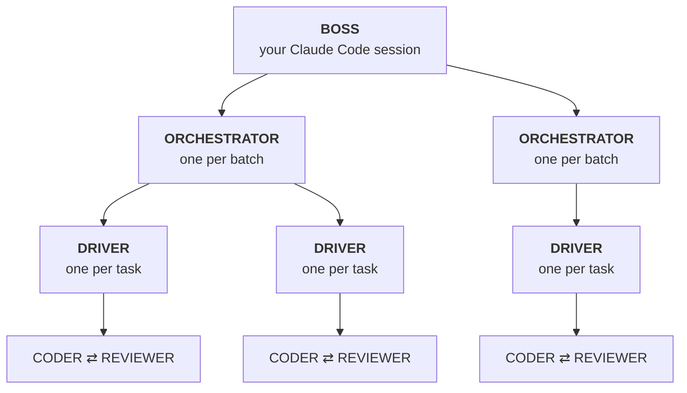

# the-crew

Hand [Claude Code](https://docs.claude.com/en/docs/claude-code/overview) a list of issues and get back reviewed, tested, merged changes. Several run in parallel, each in its own git worktree.



- **Boss.** Your session. It reads the issues and the code and writes a precise **contract** for each task. Later it reacts to events: approving merges, replanning a stuck task, or asking you about a product decision.
- **Orchestrator** and **driver.** Plain Node scripts. The orchestrator schedules tasks by their dependencies. The driver loops a **coder** and an independent **reviewer** (both `claude -p`) through scope checks, tests and review until the change is approved and green.

**Why it's built this way:** models are used only where judgment is needed (writing code, reviewing it, diagnosing an unexpected failure). Everything with a verifiable answer is a script: reading issues, scheduling, scope, tests, git and merge eligibility. That makes runs cheaper, repeatable and safe to leave alone:
- Scripts don't hallucinate a passing test.
- A model can't merge a change whose checks failed.

## Works with your setup

- **Any issue source.** `issues.json`, an `issues/` folder or `issues.md` work as they are, and so do GitHub Issues. For anything else (a `TODO.md`, a backlog doc, a CSV, a tracker export), `/crew adapt` writes a small deterministic adapter and proves it reads every issue correctly.
- **Local or pull requests.**
  - By default, approved work is squash-merged on your machine and nothing is pushed.
  - With `"delivery": { "mode": "github" }`, each task becomes a PR that must pass CI, and the crew merges the PR.
- **Any stack.** The boss works out your test, lint and build commands, the services tests need, and the files that must never change in parallel, then writes them into `.claude/crew.config.json`.

## Features

- **Contracts, validated before anything spends.** Each task has a prose contract for the models and a machine contract for the scripts: allowed files, check commands, gates, models, budgets. `crew validate` checks them against the base branch:
  - paths and npm scripts exist;
  - issue ids are real;
  - docs anchors match;
  - tasks touching the same files are ordered.
- **An enforced loop.**
  - Scope is a diff against the base.
  - Checks are exit codes.
  - The reviewer only sees code that already passes.
  - Loops stop when they stop converging.
- **Isolation.** Coder and reviewer run with limited tools, no MCP servers, and inside Claude Code's OS sandbox. The sandbox fails closed, and they can't commit, push, merge or read secrets.
- **Crash-safe.** Every process resumes from its status file, and merges, PRs and comments are idempotent. Hung or dead drivers are detected, and a triage call diagnoses them and may repair the environment.
- **The boss can veto a merge but never override a failed gate.**
- **Cheap by default.**
  - A Haiku coder and a Sonnet reviewer.
  - One cached system prompt shared by every call of a role, with a 1-hour cache.
  - A coder that resumes its session between rounds.
  - Every call recorded in a cost ledger: `crew cost <run>`.
- **Watchable.** `crew status`, `crew watch <run> <task>`, and a live read-only dashboard on localhost.

## Requirements

- macOS or Linux, with [Claude Code's sandbox](https://docs.claude.com/en/docs/claude-code/sandboxing) available. Calls refuse to run without it. Only macOS has been tested so far.
- [Claude Code](https://docs.claude.com/en/docs/claude-code/setup) CLI, logged in (`claude -p` must work).
- Node.js 22 or newer, and git. The project must be a git repository.
- For GitHub Issues or github delivery: the [GitHub CLI](https://cli.github.com/), authenticated (`gh auth status`). With github delivery, the repository needs CI on pull requests.

## Install

From a clone of this repository:

```sh
scripts/install.sh /path/to/your/project   # → your-project/.claude/skills/crew
# or, once for every project:
scripts/install.sh --user                  # → ~/.claude/skills/crew
```

Then add the crew's runtime directories to the project's `.gitignore`:

```gitignore
.claude/crew/runs/
.claude/crew/locks/
.worktrees/
```

## Use

In Claude Code, inside your project, on your strongest model:

```text
/crew adapt                    # once per project: config + issue reader, proven with crew doctor
/crew 12 14 15                 # plan these issues, validate, launch, run to the end
/crew plan-only 12 14 15       # write and validate the plan, then stop for you to read it
/crew rehearse <run-id>        # dry run: real coder/reviewer rounds, never merged
/crew run <run-id>             # launch a saved plan
/crew status <run-id>          # task table and cost
/crew cost <run-id>            # spend per task, role and model
/crew stop <run-id>
/crew resume <run-id>
```

`/crew` with issue ids authorizes every step of the configured delivery:
- **local:** worktrees, commits, local merges and issue status updates;
- **github:** pushes, PRs, PR merges and one docs PR.

It never authorizes deploying, publishing, or work beyond the contracts.

**A good first run:** `/crew adapt`, then `/crew plan-only <one small issue>`, then read the contract it wrote, then `/crew rehearse <run-id>`.

The boss drives everything through a CLI that you can use too, from the project root:

| command | what it does |
| --- | --- |
| `doctor` | check the machine, the repo, the config and the issue source |
| `issues [--json] [--check]` | every issue from the project's tracker, read deterministically |
| `validate <run>` | contract and batch checks; must pass before `start` |
| `start <run> [batch…]` | mark the run's issues in progress, launch an orchestrator per batch |
| `status <run>` | task table: state, phase, round, cost, liveness |
| `follow <run> [types]` | stream new events, one per line |
| `event <run> <type> <task> [json]` | record a boss decision (`retry`, `replanned`, `abandoned`, `blocked`, …) |
| `merge-check <run> <task>` | deterministic merge eligibility (exit 0 eligible, 3 when the base moved) |
| `merge <run> <task>` | re-check, squash-merge (locally, or the PR), update the issue |
| `wrapup <run>` | apply merged tasks' docs edits (github: as one PR) |
| `watch <run> <task>` | follow a driver live |
| `cost <run>` | spend per task, role and model, with cache reads vs writes |
| `stop <run>` | stop orchestrators and drivers; nothing is merged |

Run it as `node .claude/skills/crew/crew.mjs <command>`. The live dashboard is `node .claude/skills/crew/dashboard.mjs <run>`, then open http://127.0.0.1:4777.

## Examples

- [`examples/local/`](examples/local/): a config for local delivery, and an `issues.json`.
- [`examples/github/`](examples/github/): a config for GitHub Issues with PR delivery.
- [`examples/runs/20260101-truncate-titles/`](examples/runs/20260101-truncate-titles/): a complete one-task run, the way the boss writes it:
  - [`PLAN.md`](examples/runs/20260101-truncate-titles/PLAN.md)
  - the prose contract [`WEB-TITLE-1.md`](examples/runs/20260101-truncate-titles/contracts/WEB-TITLE-1.md)
  - the machine contract [`WEB-TITLE-1.json`](examples/runs/20260101-truncate-titles/contracts/WEB-TITLE-1.json)
  - its batch

## Docs

- [How it works](docs/how-it-works.md): the crew, the stages, issue sources, the task loop, delivery modes, task states, crash safety, with diagrams.
- [Configuration](docs/configuration.md): issue sources, delivery, attribution, locks, sandbox, environment switches, batches.
- [Security model](docs/security.md): what each role can do, the sandbox, and what stays your responsibility.
- [Cost](docs/cost.md): default models, prompt caching, the cost ledger.
- References the boss reads:
  - [config fields](skill/references/config.md)
  - [issue sources](skill/references/issues.md)
  - [machine contract](skill/references/contract-json.md)
  - [prose contract](skill/references/contract.md)
  - [protocol](skill/references/protocol.md)

## Repository layout

```text
skill/              the installable skill
  SKILL.md          the boss's playbook: adapt, plan, run, merge, wrap up
  crew.mjs          CLI used by the boss and by you
  orchestrator.mjs  one per batch: scheduling, health, triage
  driver.mjs        one per task: the coder ⇄ reviewer loop (and push, PR, CI in github mode)
  lib.mjs           config, events and state machine, contracts, locks, sandbox, claude -p, cost ledger
  issues.mjs        built-in issue formats, GitHub Issues, and the adapter hook
  dashboard.mjs     live read-only view of a run (dashboard.html)
  prompts/          coder, reviewer and triage role prompts
  references/       config, issue sources, contracts, protocol
  templates/        issue adapter template (a TODO.md checklist)
docs/               how it works, configuration, security, cost
examples/           local and github configs, an issues.json, a complete example run
scripts/install.sh  copies skill/ into a project or ~/.claude/skills
test/               unit tests (npm test)
```

## Limits

- No run-wide budget or pre-run cost estimate yet. Budgets are per call.
- The boss session's own spend isn't in the cost ledger.
- Hitting a subscription's usage limit shows up as a failed call, not as a pause.
- Pull-request delivery supports GitHub only, through `gh`. Issues can come from anywhere.
- On macOS, the sandbox blocks git over SSH, Docker and Apple Events inside coder and reviewer Bash. The driver runs every check outside the sandbox, so this only limits the coder's self-checks.

## Development

```sh
npm test        # unit tests
npm run check   # syntax-check every script, then the tests
```

There are no dependencies: the scripts use only Node's standard library.

## License

[MIT](LICENSE)
