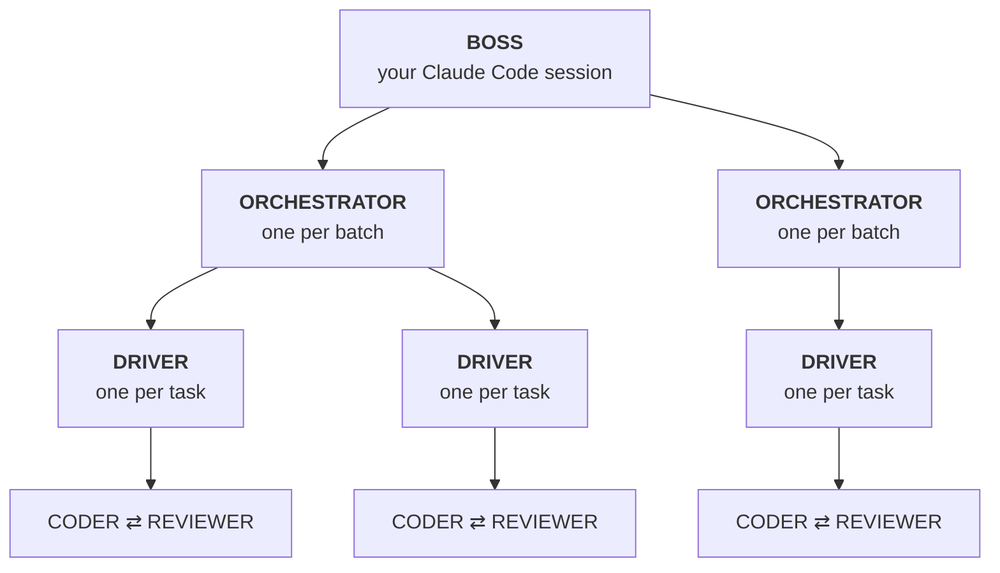

# the-crew

**An autonomous, multi-agent delivery workflow for [Claude Code](https://docs.claude.com/en/docs/claude-code/overview).** You pick issues. Your Claude Code session acts as tech lead and turns each one into a precise spec. A crew of background agents then implements, tests, reviews and merges every task in parallel, each in its own git worktree, while you do something else.

You come back to merged changes, each with a report of what changed, the evidence that every acceptance criterion passed and what it cost. Or you come back to a short list of decisions only you can make.



## Why not just ask Claude Code?

A single session works one issue at a time, grades its own work, and needs you watching. The crew changes that:

- **Parallel and isolated.** Every task gets its own branch, worktree and agents. Tasks that touch the same files are ordered automatically.
- **"Done" is decided by your tests, not by the model.** A script runs your checks and reads exit codes. A model saying "tests pass" counts for nothing, and a change with a red check can't be merged, not even by the boss.
- **Independent review.** A separate reviewer reads the spec and the diff, not the coder's account of its work. It only sees code that already passes, so you don't pay to review broken code.
- **It stops instead of spinning.** When fixes stop making progress, the task goes back to the boss to correct the spec. Nothing loops until the budget runs out.
- **Safe to leave alone.** Coders and reviewers run in Claude Code's OS sandbox: they write only in their worktree, can't read your credentials, and can't commit, push or merge. The checks that run their code are sandboxed too, with macOS's built-in sandbox, unless you agree to let a specific check out (an iOS simulator, say). Every process survives a crash and resumes where it stopped.
- **Cheap per task.** A Haiku coder, a Sonnet reviewer, and a prompt cache shared across agents. A one-task rehearsal measured $0.05–0.09.

Models do only what needs judgment: the spec, the code and the review. Scheduling, scope checks, tests, git and merge decisions are plain scripts.

## What a run looks like

An illustrative session:

```text
you   /crew 12 14 15
boss  reads the issues and the code, writes a contract per task, validates them
      "3 tasks, one batch; 14 waits for 12. Starting."
crew  12 and 15 run in parallel: code → checks → review → fix → approve
boss  12 ready_to_merge → reads the diff against what merged since → merges
crew  14 starts on top of 12
boss  15 needs_replan: the contract assumed a helper that doesn't exist → fixes the spec, the task continues
boss  "12, 14, 15 merged. Nothing needs you."
```

A **contract** is the unit of work. Its prose half is a spec for the agents: steps, patterns to copy, exact strings, what's out of scope. Its machine half is for the scripts: the files the task may touch, the check commands, models and budgets. [See an example](examples/runs/20260101-truncate-titles/contracts/WEB-TITLE-1.md).

## Is it a fit?

**Good fit:** a backlog of issues that each touch a handful of files, in a repo where tests, lint and a build run from the command line.

**Poor fit:** vague product work, big redesigns, or a repo with no runnable checks. The crew is only as trustworthy as the checks it can run.

## Works with your setup

- **Issues from anywhere.** `issues.json`, an `issues/` folder, `issues.md` and GitHub Issues work as they are. For anything else (a `TODO.md`, a CSV, a tracker export), `/crew adapt` writes a small parser and proves it reads every issue.
- **Local or PRs.** By default, approved work is squash-merged on your machine and nothing is pushed. With `"delivery": { "mode": "github" }`, each task becomes a PR that must pass CI, and the crew merges it only when you ask (`/crew merge`).
- **Any stack.** `/crew adapt` works out your test, lint and build commands, the services tests need, and the files that must never change in parallel.

## Quickstart

You need macOS or Linux, Node 22+, git and the [Claude Code CLI](https://docs.claude.com/en/docs/claude-code/setup), logged in. GitHub Issues and PR delivery also need an authenticated [`gh`](https://cli.github.com/). Only macOS has been tested so far.

```sh
git clone https://github.com/joaoveronezi/the-crew
the-crew/scripts/install.sh /path/to/your/project   # or --user for ~/.claude/skills
```

Then, in Claude Code inside your project, on your strongest model:

```text
/crew adapt                  # once: writes .claude/crew.config.json and checks the machine
/crew plan-only 12           # writes and validates the contract for issue 12, then stops
/crew rehearse <run-id>      # real coder/reviewer rounds, never merged
/crew 12 14 15               # plan, run, merge, wrap up
```

Start with one small issue, and read the contract before you rehearse it. That's where a misunderstanding costs nothing to fix.

Follow a run with `/crew status <run-id>` and `/crew cost <run-id>`. For a live view, run `node .claude/skills/crew/dashboard.mjs` once and leave it open at http://127.0.0.1:4777. It reads like a chat app: every run is a thread you open to see its batches, and every task is a conversation in which the boss, coder, checks and reviewer talk, plus an everyone channel per run. New runs show up on their own. Pass a run id to show only that run.

## Docs

- [How it works](docs/how-it-works.md): the task loop, when and why a task stops, delivery modes, crash safety, every command.
- [Configuration](docs/configuration.md): issue sources, delivery, locks, sandbox, attribution.
- [Security](docs/security.md): what each agent can and can't do, and what stays your responsibility.
- [Cost](docs/cost.md): models, caching, measured numbers, the cost ledger.

## Limits

- Budgets are per call. There's no run-wide budget or pre-run estimate yet, and the boss session's own spend isn't tracked.
- A dropped connection or an overloaded API is waited out for about two hours. A subscription usage limit that lasts longer still stops the task for the boss.
- PR delivery is GitHub only. Issues can come from anywhere.

## License

[MIT](LICENSE)
