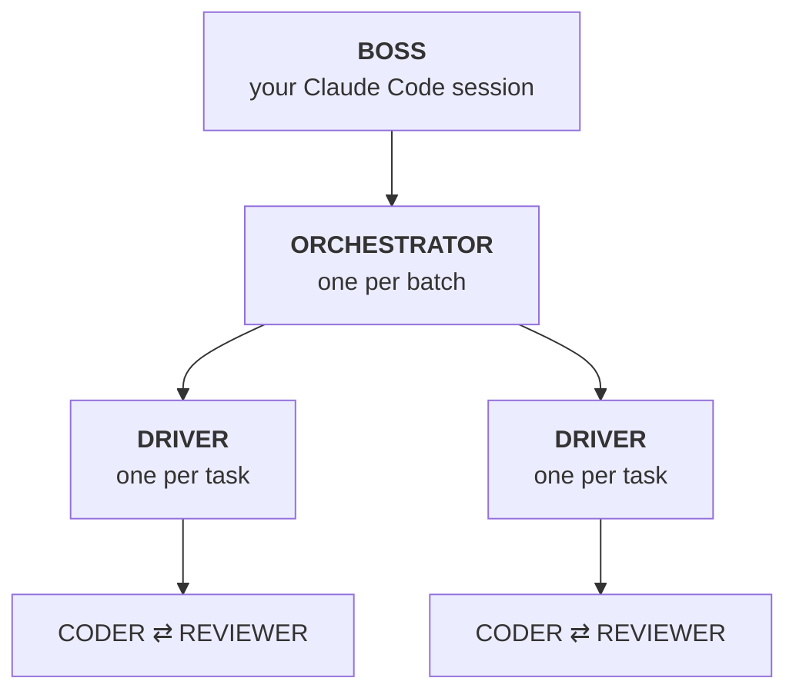
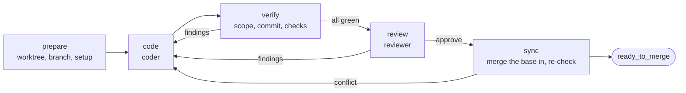

# How it works

The rule behind the design: **a model does only what needs judgment, and a script does everything with a verifiable answer.** So a model writes the spec, the code and the review, and scripts handle scheduling, scope, tests, git and merge eligibility. That's what makes a run safe to leave alone: a script can't hallucinate a passing test.

## The roles

| role | what it is | its job |
| --- | --- | --- |
| **Boss** | your Claude Code session, following [`SKILL.md`](../skill/SKILL.md). Use your strongest model | writes one contract per task, then reacts to events: approves or vetoes merges, fixes specs that turned out wrong, asks you only for product decisions |
| **Orchestrator** | `orchestrator.mjs`, a background Node process per batch | starts tasks when their dependencies are merged and a slot is free; restarts dead or hung drivers; calls a short-lived **triage** model to diagnose a broken environment |
| **Driver** | `driver.mjs`, a background Node process per task, in its own worktree | runs the loop below. It has no judgment: it only routes results |
| **Coder** | `claude -p`, sandboxed | implements the contract, or fixes the findings it's given. Default: Haiku |
| **Reviewer** | `claude -p`, sandboxed, read-only, fresh every round | checks the diff against the contract, judges the criteria no command can check, reviews the code. Default: Sonnet |

The boss's thinking happens once, up front, in the contracts. If a coder would need to make a design decision, the contract wasn't ready.

## One task, start to finish

- **Scope is a diff, not a request.** The driver diffs the branch against the base. A file outside the contract's `allowed_files` becomes a finding, and it's never committed.
- **Checks are exit codes.** A failed check goes straight back to the coder with its output. The reviewer only sees code that already passes.
- **Only the driver commits.** The coder can't stage, commit, push or merge.
- **The base is merged in, never rebased.** Every check runs again afterwards, so what gets merged is exactly what was checked.
- **Loops converge or stop.**
  - The reviewer marks each earlier finding `fixed`, `partial` or `not_fixed`, and may add only *new* problems as new findings, so it can't keep moving the goalposts.
  - The same finding `not_fixed` twice, or the same failing output two rounds in a row, stops the task as `needs_replan`.
  - `max_rounds` (default 3) is the hard cap.

## When a task stops

A task stops when it needs a decision. Everything else continues.

| state | meaning | what happens |
| --- | --- | --- |
| `ready_to_merge` | approved, every check green, up to date with the base | the boss runs `crew merge-check`, reads the diff and the report, then merges (`local`) or vetoes. With `github` delivery it reports the PR as ready and merges only when you ask |
| `needs_replan` | the contract can't produce a correct change | the boss fixes that contract (version +1) and the driver continues on the same branch |
| `help` | the environment is broken: a database is down, a port is taken | triage diagnoses it and may repair it; the task resumes |
| `escalate` | over budget, or triage couldn't fix it | the boss retries, replans, blocks or abandons |
| `blocked` | needs a product decision or new scope | the boss tells you. Independent tasks continue |
| `needs_human` | merged, but an acceptance criterion needs a person (a device test, a visual check) | the issue stays open for you |

The boss can veto a change that passed every gate, but it can never merge one that failed a gate: `crew merge` re-checks eligibility and refuses.

## Contracts

Each task has two files in the run directory, written by the boss:

- **`contracts/<id>.md`**: the spec the coder and reviewer read. Steps, patterns to copy, exact strings, what's out of scope, when to give up. Template: [`contract.md`](../skill/references/contract.md).
- **`contracts/<id>.json`**: what the driver executes. Allowed files, check commands, gates, locks, models, budgets, commit message, docs edits. Reference: [`contract-json.md`](../skill/references/contract-json.md).

`crew validate` checks every contract against the base branch before anything is spent:
- `edit` paths exist and `create` paths don't;
- every named `npm run` script exists;
- issue ids are real;
- docs anchors match exactly once;
- tasks that touch the same files are ordered;
- no task touches the issue files or the crew itself.

## Delivery: local or pull requests

| | `local` (default) | `github` |
| --- | --- | --- |
| branches start from | the local base branch | `<remote>/<base>` |
| after approval | the task waits for the boss | the driver pushes, opens a PR with the report as its body, and waits for CI. Red CI is re-run once per commit before it counts as a finding |
| `crew merge` | squash-merges on your machine, with the report as the commit body | squash-merges the PR with `gh`, at the approved commit. The boss runs it only when you ask (`/crew merge`); dependants wait until then |
| issue status | updated with the merge | GitHub Issues are commented and closed; file trackers are updated in the wrap-up PR |
| `crew wrapup` | commits every merged task's docs edits | opens one docs PR, merged only when you ask |

The loop, contracts and gates are identical in both modes.

## Crash safety

Any process can be killed at any moment and resumed with `crew start <run>`:

- Every state change is an event in `events.jsonl`, checked against a state machine, so illegal moves such as `merged` without `ready_to_merge` are refused.
- Drivers save their phase before acting and continue from it when relaunched.
- Processes are identified by pid **and** start time, so a recycled pid never counts as alive and is never killed.
- Merges, PRs, comments and wrap-ups that finished just before a crash are recognized and recorded, not repeated.

## Commands

The boss drives everything through this CLI, and you can use it too: `node .claude/skills/crew/crew.mjs <command>`, from the project root.

| command | what it does |
| --- | --- |
| `doctor` | checks the machine, the repo, the config and the issue source |
| `issues [--json] [--check]` | lists every issue from the tracker |
| `validate <run>` | checks contracts and batches; must pass before `start` |
| `start <run> [batch…]` | marks the issues in progress and launches an orchestrator per batch; also resumes a stopped run |
| `status <run>` | one line per task: state, phase, round, cost, liveness |
| `watch <run> <task>` | follows a driver live, including what its coder or reviewer is doing |
| `cost <run>` | spend per task, role and model, with cache reads vs writes |
| `follow <run> [types]` | streams new events, one per line |
| `merge-check <run> <task>` | deterministic merge eligibility (exit 0 eligible, 3 when the base moved) |
| `merge <run> <task>` | re-checks, squash-merges, updates the issue |
| `event <run> <type> <task> [json]` | records a decision: `retry`, `replanned`, `blocked`, `abandoned`, … |
| `wrapup <run>` | applies merged tasks' docs edits |
| `stop <run>` | stops orchestrators and drivers. Nothing is merged; branches stay |

## The run directory

Everything about a run lives in `.claude/crew/runs/<run>/`. Keep it gitignored.

| path | what's in it |
| --- | --- |
| `PLAN.md`, `contracts/`, `batches/` | the plan, written by the boss |
| `reports/<id>.md` | per task: summary, acceptance evidence, review notes, cost. Becomes the merge commit or PR body |
| `events.jsonl` | every state change, append-only |
| `cost.jsonl` | one line per model call |
| `drivers/<id>.json` | each driver's phase, round, findings and heartbeat |
| `logs/<id>/` | the driver log, every coder and reviewer call, check output, triage |
