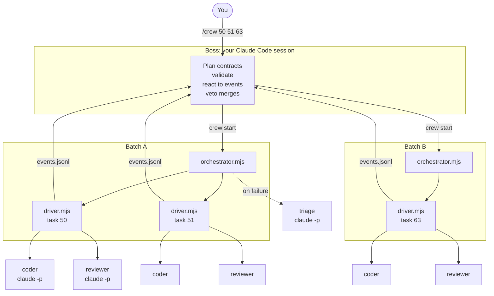
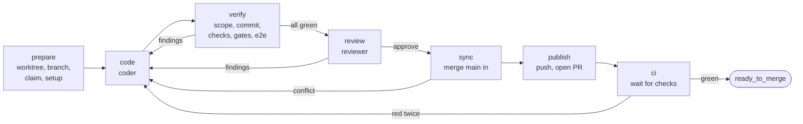
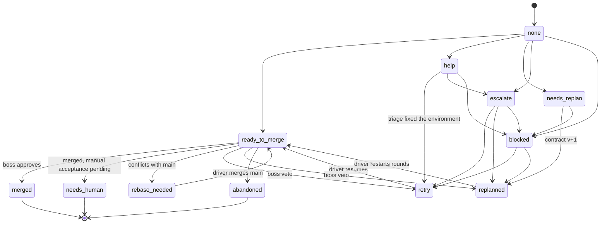
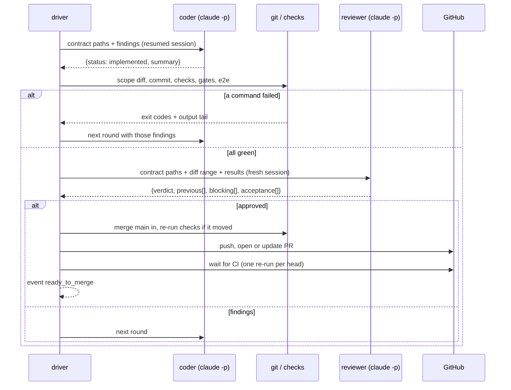

# How it works

The crew turns a list of GitHub issues into merged pull requests. The idea behind it: **use a language model only where judgment is needed, and plain scripts for everything with a verifiable answer.** Scheduling, scope checks, running tests, pushing, waiting for CI and deciding whether a PR may merge all have right answers, so scripts do them. Writing code, reviewing it, and diagnosing an unexpected failure don't, so models do them.

## The three tiers

| tier | what it is | judgment |
| --- | --- | --- |
| **Boss** | Your interactive Claude Code session, following [`SKILL.md`](../skill/SKILL.md). Run it on your strongest model | Writes the contracts, replans failed ones, can veto a merge, talks to you |
| **Orchestrator** | `orchestrator.mjs`, one detached Node process per batch | None. It schedules tasks and watches driver health. Diagnosis of a failure goes to a `claude -p` **triage** call |
| **Driver** | `driver.mjs`, one detached Node process per task | None. It *is* the loop between coder and reviewer |
| **Coder** | `claude -p` with [`prompts/coder.md`](../skill/prompts/coder.md) | Implements the contract, or fixes the findings it's given |
| **Reviewer** | `claude -p` with [`prompts/reviewer.md`](../skill/prompts/reviewer.md), a fresh session every round | Contract adherence, judgment acceptance criteria, code review |

The boss does all the thinking once, up front, and writes it down as contracts precise enough that a cheaper model only has to follow them. If a coder would need to make a design decision, the contract wasn't ready.

## Contracts

Each task has two files in the run directory:

- **`contracts/<ID>.md`**: the prose. Steps, patterns to copy, exact strings, what's out of scope, when to give up. The coder and reviewer read it. Template: [`contract-md.md`](../skill/references/contract-md.md).
- **`contracts/<ID>.json`**: the machine half, which the driver executes. Allowed files, check commands, gates, models, budgets, PR text, docs edits. Reference: [`contract-json.md`](../skill/references/contract-json.md).

`crew validate` checks a run before anything is spent:
- the shape of every contract;
- that every `edit` path exists on the main branch and every `create` path doesn't;
- that every `npm run` script it names exists;
- that every docs anchor matches exactly once;
- that tasks touching the same files are ordered.

## One task, from start to finish

- **A round** is one coder call plus, if everything passed, one reviewer call.
- **The reviewer only sees green code.** A failed check, gate or e2e command goes straight back to the coder as a finding. Review is the most expensive call, so it's spent only on code that already passes.
- **Scope is enforced, not requested.** The driver diffs the branch against main, and any file outside `allowed_files` becomes a `scope` finding.
- **The driver commits.** The coder can't stage, commit, push or use `gh`.
- **Main is merged in, never rebased.** Conflicts inside the allowlist go to the coder; conflicts outside it stop the task for a replan. Nothing is ever force-pushed.
- **Red CI gets one automatic re-run per commit** before it counts as a finding, so flaky jobs don't cost a round.

### Loops converge or stop

- The reviewer only adds *new* problems as new findings, so it can't keep moving the goalposts.
- A deterministic failure (check, e2e or CI) counts as "no progress" only when its output is identical two rounds in a row, ignoring digits such as timings.
- `max_rounds` (default 3) is the hard cap.

## Task states

A task's state is its last status event in `events.jsonl`. Every write is checked against this state machine, so illegal moves, such as `merged` without `ready_to_merge`, are refused.

`retry`, `replanned` and `rebase_needed` are runnable: the orchestrator relaunches the driver, which resumes from its status file. `merged`, `needs_human`, `abandoned` and `blocked` are finished. Other event types (`round`, `triage`, `driver_launched`, `batch_done`, …) are informational and don't change state.

## Who decides what

| responsibility | decided by |
| --- | --- |
| plan, contracts, acceptance criteria | boss (LLM) |
| contract validation | `crew validate` (script) |
| scheduling: dependencies, free slots | orchestrator (script) |
| worktree, branch, claim comment, setup | driver (script) |
| implementing and repairing | coder (LLM) |
| scope check, commit, checks, gates, e2e | driver (script, exit codes) |
| contract adherence, judgment ACs, code review | reviewer (LLM) |
| next round, round cap, repeated-finding stop | driver (script) |
| merging main in | driver (script); the coder resolves conflicts |
| push, PR, CI wait, one CI re-run | driver (script) |
| stall and crash detection | orchestrator (pid + heartbeat) |
| stall and crash diagnosis, environment repair | triage (LLM) |
| merge eligibility | `crew merge-check` (script) |
| final merge decision | boss (LLM), **veto only** |
| issue comment, cleanup, status docs | `crew merge`, `crew wrapup` (script) |

The boss can veto a merge that passed every gate. It can never override a failed gate: `crew merge` re-checks eligibility (state, dependencies, approved head SHA, green checks, mergeability) and refuses otherwise.

## A round, in time

## Crash safety

Every process can be killed at any moment and resumed:
- The driver writes its event *before* saving its status, so a task's state is never behind what really happened.
- Every phase saves the status file first. A relaunched driver continues from the phase it was in.
- A PR is looked up by branch before one is created, and its number is saved.
- Claim and merge comments carry hidden markers, so each is posted once.
- `crew merge` records a PR that was merged just before a crash instead of refusing it, and `crew wrapup` picks up an existing branch, commit and PR.
- Processes are identified by pid **and start time**, so a recycled pid never counts as alive or gets killed. Kills go to the crew's own process groups only.
- Locks for machine-wide resources (`e2e`, `db`, or your own) record their holder's process identity and a per-process token. A lock whose holder is gone is taken over.

## The run directory

Everything about a run lives in `<run_dir>/<run>/`, which is `.claude/loops/<run>/` by default. Keep it gitignored.

| path | written by |
| --- | --- |
| `PLAN.md`, `contracts/<id>.md`, `contracts/<id>.json`, `batches/<batch>.json` | boss |
| `events.jsonl`: append-only, checked against the state machine | everyone, through the library |
| `drivers/<id>.json`: phase, round, head, PR, findings, checks, cost, heartbeat | that task's driver |
| `orch-<batch>.json`: driver pids, restarts, triages | that batch's orchestrator |
| `cost.jsonl`: one line per `claude -p` call | the library |
| `logs/<id>/`: driver log, each coder/reviewer call as stream-json, check logs, triage | driver, orchestrator |

See also: [security](security.md) for the sandbox, and [cost](cost.md) for caching and the ledger.
