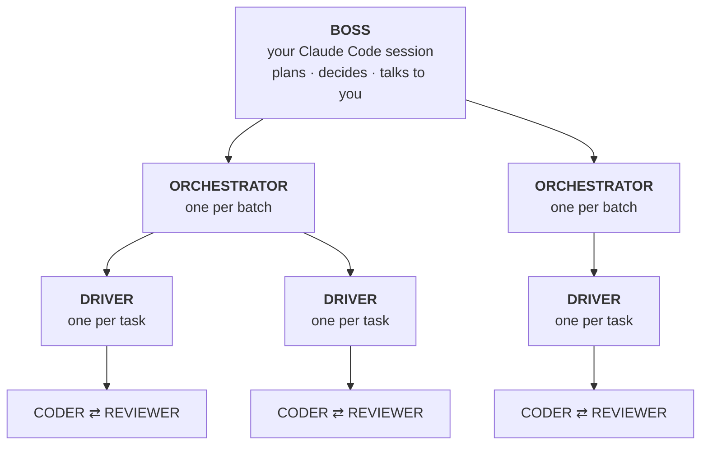
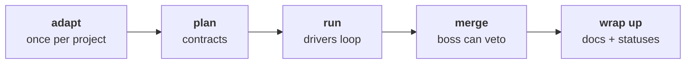
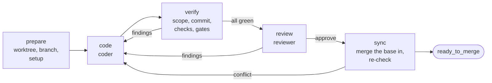
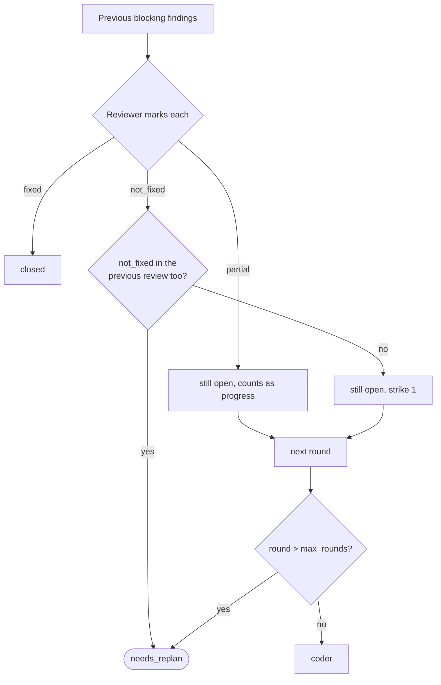
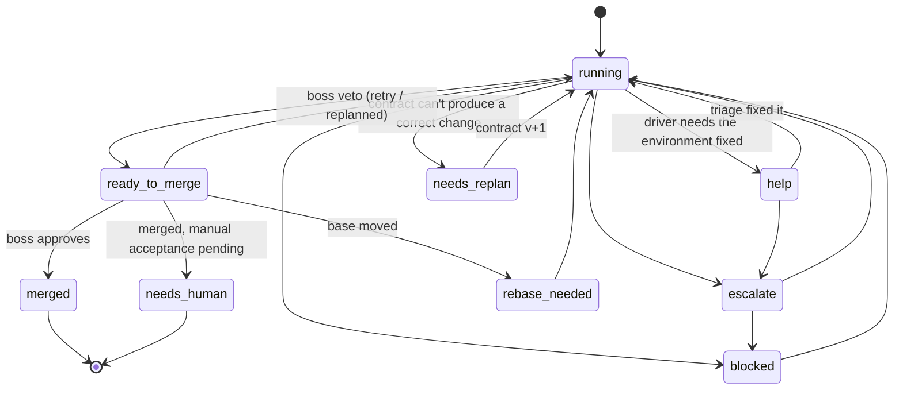

# How it works

The crew turns a list of issues into merged, reviewed changes. The idea behind it: **use a language model only where judgment is needed, and plain scripts for everything with a verifiable answer.**
- **Scripts** do what has a right answer: reading issues, scheduling, scope checks, running tests and deciding whether a change may merge.
- **Models** do what doesn't: writing code, reviewing it, and diagnosing an unexpected failure.

## The crew

| who | what it is | thinks? |
| --- | --- | --- |
| **Boss** | Your interactive Claude Code session, following [`SKILL.md`](../skill/SKILL.md). Run it on your strongest model | Yes. It adapts the crew to the project, writes the contracts, replans a stuck task, can veto a merge, and talks to you |
| **Orchestrator** | `orchestrator.mjs`, one Node process per batch | No. It starts tasks when their dependencies are done and a slot is free, and notices dead or hung drivers. It hands the *diagnosis* of a failure to a short-lived triage model |
| **Driver** | `driver.mjs`, one Node process per task, in its own git worktree | No. It *is* the loop between coder and reviewer: scope, commit, checks, hand-off |
| **Coder** | `claude -p` with [`prompts/coder.md`](../skill/prompts/coder.md), sandboxed | Yes. It implements the contract, or fixes the findings it's given |
| **Reviewer** | `claude -p` with [`prompts/reviewer.md`](../skill/prompts/reviewer.md), sandboxed and read-only, fresh every round | Yes. It checks contract adherence, judges the acceptance criteria no command can check, and reviews the code |

The boss does the thinking once, up front, and writes it down as **contracts** precise enough that a cheaper model only has to follow them. If a coder would need to make a design decision, the contract wasn't ready.

## The stages

1. **Adapt** (`/crew adapt`, once per project). The boss reads the project and writes `.claude/crew.config.json`:
   - the base branch;
   - the exact test, lint and build commands;
   - services tests need, which become locks;
   - files two tasks must never change in parallel;
   - secret files and allowed network hosts;
   - **where the issues live**.

   Then it proves that the crew reads the issues correctly, and that the machine is ready (`crew doctor`).
2. **Plan** (`/crew 12 14 15`). The boss reads the selected issues through `crew issues --json` and the code they touch. It writes one contract per task, groups tasks into batches, and runs `crew validate`, which checks every contract against the base branch before anything is spent.
3. **Run.** `crew start` launches one orchestrator per batch, and each orchestrator launches drivers. The boss waits for events instead of polling.
4. **Merge.** When a task is approved and green, the boss gets `ready_to_merge`. `crew merge-check` proves eligibility. The boss looks at what the gates can't see, such as integration risk with what merged since, and either approves (`crew merge`) or vetoes.
5. **Wrap up.** `crew wrapup` applies every merged task's docs edits in one go, so parallel tasks never conflict on a status doc.

## Where issues come from

The crew never asks a model to read an issue file. `crew issues` reads them deterministically from one of these:

| source | how |
| --- | --- |
| `issues.json` | an array of `{ id, title, status, … }` |
| `issues/` | one markdown file per issue, with front matter |
| `issues.md` | one file, one `## <id>: <title>` section per issue |
| GitHub Issues | read with the `gh` CLI |
| anything else | a TODO list, a CSV, a roadmap doc or a tracker export: `/crew adapt` writes a small **adapter script** for it, a plain parser with no network and no model, and proves it with `crew issues --check` |

The crew writes back only an issue's status (`open` → `in_progress` → `done`) and a dated note. Details: [issue sources](../skill/references/issues.md).

## Contracts

Each task has two files in the run directory:

- **`contracts/<ID>.md`**: the prose. Steps, patterns to copy, exact strings, what's out of scope, when to give up. The coder and reviewer read it. Template: [`contract.md`](../skill/references/contract.md).
- **`contracts/<ID>.json`**: the machine half, which the driver executes. Allowed files, check commands, gates, locks, models, budgets, the commit message and docs edits. Reference: [`contract-json.md`](../skill/references/contract-json.md).

`crew validate` refuses a run unless:
- every `edit` path exists on the base branch, and every `create` path doesn't;
- every `npm run` script named exists;
- every issue id is in the tracker;
- every docs anchor matches exactly once;
- tasks touching the same files are ordered;
- no task touches the issue files or the crew's own files.

## One task, start to finish

- **A round** is one coder call plus, if everything passed, one reviewer call.
- **The reviewer only sees green code.** A failed check goes straight back to the coder as a finding. Review is the more expensive call, so it's spent only on code that already passes.
- **Scope is enforced, not requested.** The driver diffs the branch against the base, and any file outside `allowed_files` becomes a finding. It's never committed.
- **The driver commits.** The coder can't stage, commit, push, merge or use `gh`.
- **The base is merged in, never rebased.** Every check runs again afterwards, so what gets merged is exactly what was checked. Conflicts outside the task's files stop it for a replan.

### Loops converge or stop

- The reviewer adds only *new* problems as new findings, so it can't keep moving the goalposts.
- A failed command counts as "no progress" only when its output is identical two rounds in a row, ignoring digits such as timings.
- `max_rounds` (default 3) is the hard cap.

## Delivery: local or pull requests

How an approved task reaches the base branch is one setting, `delivery.mode`:

| | `local` (default) | `github` |
| --- | --- | --- |
| branches start from | the local base branch | `<remote>/<base>` |
| after approval | the driver hands off | the driver pushes, opens or updates a PR (the report is its body), and waits for CI. Red CI is re-run once per commit before it counts as a finding |
| `crew merge` | squash-merges into the base branch on this machine, with the task's report as the commit body | squash-merges the PR through `gh` at the approved commit |
| issue status | committed with the merge | GitHub Issues: commented and closed. File trackers: committed in the wrap-up PR |
| `crew wrapup` | commits the docs edits on the base branch | opens one docs PR |

The loop, the contracts and the gates are the same in both.

## Task states

A task's state is its last status event in `events.jsonl`. Every write is checked against this state machine, so illegal moves, such as `merged` without `ready_to_merge`, are refused.

"running" stands for the runnable states (`none`, `retry`, `replanned`, `rebase_needed`). In all of them the orchestrator relaunches the driver, which resumes from its status file. Any task can also be `abandoned`.

## Who decides what

| responsibility | decided by |
| --- | --- |
| adapting to the project, plan, contracts, acceptance criteria | boss (model) |
| reading issues, validating contracts | `crew issues`, `crew validate` (script) |
| scheduling: dependencies, free slots | orchestrator (script) |
| implementing and repairing | coder (model) |
| scope, commit, checks and gates (exit codes) | driver (script) |
| contract adherence, judgment ACs, code review | reviewer (model) |
| next round, round cap, stopping when there's no progress | driver (script) |
| stall and crash detection | orchestrator (pid + start time + heartbeat) |
| stall and crash diagnosis, environment repair | triage (model) |
| merge eligibility | `crew merge-check` (script) |
| final merge decision | boss (model), **veto only** |
| squash merge, issue status, docs | `crew merge`, `crew wrapup` (script) |

The boss can veto a change that passed every gate, but can never merge one that failed a gate: `crew merge` re-checks eligibility and refuses.

## Crash safety

Every process can be killed at any moment and resumed:
- A driver writes its event *before* saving its status, so a task's state is never behind what really happened.
- Each phase saves the status file first, and a relaunched driver continues from the phase it was in.
- Processes are identified by pid **and start time**, so a recycled pid never counts as alive and is never signalled. Kills go to the crew's own process groups only.
- A merge that finished just before a crash is recognized and recorded rather than repeated: by its `Crew-Task` commit trailer in local mode, and by the PR's state in github mode. The same goes for a PR or a wrap-up that already exists.
- Locks for shared resources record their holder's process identity. A lock whose holder is gone is taken over.

## Watching a run

- `crew status <run>`: one line per task, with state, phase, round and cost.
- `crew watch <run> <task>`: the driver log plus what the current coder or reviewer call is doing.
- `node .claude/skills/crew/dashboard.mjs <run>`, then open http://127.0.0.1:4777: a live, read-only view of the boss → orchestrators → drivers tree, each task's phase, checks and cost, and the event feed. It serves on localhost only.

## The run directory

Everything about a run lives in `.claude/crew/runs/<run>/` (the location follows `stateDir`). Keep it gitignored.

| path | written by |
| --- | --- |
| `PLAN.md`, `contracts/<id>.md`, `contracts/<id>.json`, `batches/<batch>.json` | boss |
| `events.jsonl`: append-only, checked against the state machine | everyone, through the library |
| `drivers/<id>.json`: phase, round, head, findings, checks, cost, heartbeat | that task's driver |
| `orch-<batch>.json`: driver pids, restarts, triages | that batch's orchestrator |
| `reports/<id>.md`: summary, acceptance evidence, review notes, cost | driver at hand-off; becomes the merge commit body or PR body |
| `cost.jsonl`: one line per model call | the library |
| `logs/<id>/`: driver log, each coder/reviewer call, check logs, triage | driver, orchestrator |

See also: [configuration](configuration.md), [security](security.md), [cost](cost.md).
